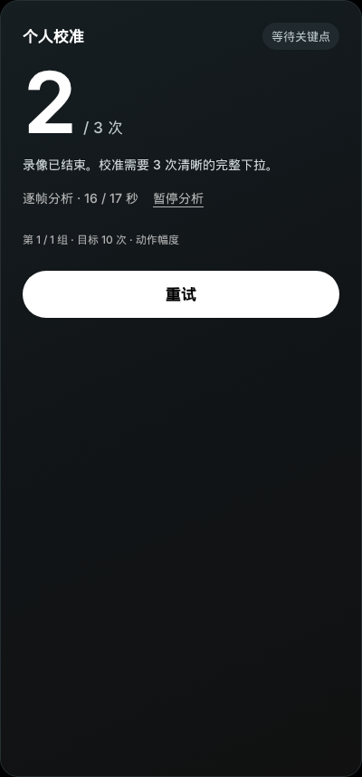
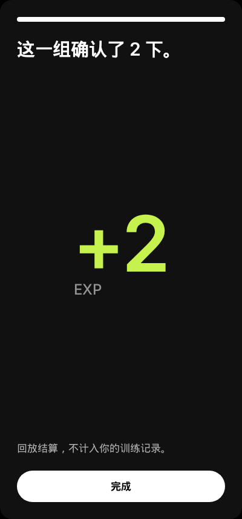

# Calibration and repetition-count repair

This report preserves the earlier 71c4bfd repair and its six-source check. The subsequent [recorded-pose recovery](recording-recovery.md) improved the same development cohort to 22/36 and adds a separate four-source comparison; the earlier six sources were not rerun in that follow-up.

The fixed eighteen-clip development cohort changed from **18 of 36** matched formal reference repetitions to **20 of 36**, with **16 missed** and **0 unmatched confirmed events** after the repair. All previously matched reference windows were retained. The six additional source-held-out recordings changed from **2 of 10** to **2 of 10**, with **0 unmatched confirmed events** in the candidate. These are provisional source-window matches, not population accuracy or proof that all calibration failures are resolved.

## What changed in actual use

Life Time previously ended at two calibration cycles despite five complete reference movements. The candidate completed calibration at 9.93 s and confirmed the remaining two repetitions. A wrist can now be unobservable inside the image, as well as outside its upper border, without discarding a separately observed complete upper-arm cycle. The shoulder and elbow must remain directly usable, the bottom flexion must actually be visible, and three qualifying cycles are still required. These are count-only repetitions: their elbow-range score is null, they receive no range/improvement bonus, and no unsupported bilateral or wrist-trace measurement is manufactured.

Calibration now hands its directly observed completion frame to formal elbow counting. This removes a mismatch where the calibration return was accepted but the next set counter demanded a more extended starting pose before accepting the first formal cycle. A brief idle dropout can re-arm only from a directly reobserved matching overhead position; this does not stitch an interrupted descent and return into a verified repetition.

All three counting paths clear accumulated calibration cycles after an explicit position discontinuity. A separate last valid calibration position survives empty frames, so inserting a blank frame before a view change cannot bypass that check. Ordinary brief loss without a displaced returning position does not automatically clear every earlier cycle. The handheld Pexels 35585697 clip consequently no longer finishes calibration; the baseline only finished near the final return and also produced zero formal counts. That stricter outcome is not counted as a recognition gain.

Classroom recording previews now use the same complete source-time sampling as ordinary replay. Live cameras remain live streams. On the compute-only browser, the earlier playback-paced preview ended with no completed calibration; complete sampling recovered the four formal repetitions in the bundled rear-view demonstration. Processing may take longer than the source duration, so recording previews remain labelled recording data and excluded from real-camera participant comparisons. Their wall-clock cue timing is not evidence about interruption during real-time training.

## Same-recording screenshots

The actual Life Time UI ended at calibration 2/3 before the repair. After the repair, it completed calibration and reached the two-repetition result. The displayed +2 EXP is replay-only settlement and does not update personal progress; the on-screen footer states that distinction. These are cropped UI screenshots, not source video frames.

## Evaluation design and limits

The original eighteen clips remain development/regression material, with every original file, reference interval, and matching tolerance retained. Thirteen clips contain 36 formal reference movements; four have no post-calibration reference movements, and one close-up is unscorable. No failed clip was removed. The development baseline is the earlier eighteen-clip audit; its five recorded counter-dependency hashes match commit `9fc67be`. All eighteen candidate runs were fresh. Both versions of the six held-out sources were run fresh. Calibrated clips remained at nine; that aggregate must not be substituted for the formal-repetition result.

The [held-out source manifest](results/recognition-heldout-sources.json) adds six different source groups: Anil Sharma, Gaurav Kumar, Ketut Subiyanto, MIT OpenCourseWare, cottonbro studio and MART PRODUCTION. Original files were used without temporal clipping, looping or spatial cropping. Their hashes and download URLs are included. Complete cycles were visually annotated at 0.25-second spacing before detector evaluation. Three clips provide ten formal reference repetitions; three shorter clips provide none and remain abstention/runtime checks. Some clips crop necessary joints or contain moving cameras. The references are provisional, non-independent visual labels, not independent human ground truth; source-held-out does not mean unseen by the underlying pretrained model.

The [freeze record](results/recognition-evaluation-freeze.json) fixes the candidate source hashes and annotated manifest before held-out inference. The job verifies those hashes before running baseline and candidate. No candidate tuning used the held-out outcomes. Baseline is commit `9fc67be`; both variants use the same full pose model, original files, 15 Hz source-position schedule and CPU browser environment. All decoding, inference, tests, builds and browser rendering ran on allocated HPC compute nodes.

Each actual application run checks its final state, review/export consistency where calibration completes, mobile width, browser errors and absence of persistent replay rewards. A separate audit replays the exact delivered frames and must reproduce the UI's calibration and verified count before matching timestamped completion events. The initial UI report cannot locate count-only events from wrist traces; its trace-only match totals are not the primary score. The timestamp audit includes those events without automatically declaring them extra or silently dropping them.

## What remains unresolved

Dynamic still misses the first visible top in the raw pose output and corrupts an arm near the final return. Adelaide's view changes, Mixkit's projected arm motion, the handheld portrait Pexels clip, and the front-oblique Szat squat remain difficult. The Szat clip contains a nearby spotter and unstable or missing leg estimates. These remain recorded failures, not evidence that the people did not exercise. Blindly reducing confidence requirements, filling missing joints, or accepting incomplete returns was not used to improve the score.

Neither variant recovered the first formal Gaurav pulldown; each matched its final two. Both failed calibration on the two held-out squat clips with formal reference repetitions, cottonbro and MART. MIT completed calibration without inventing a formal repetition; the two other short or cropped controls did not complete calibration. The held-out result supplies no evidence of a general recognition improvement.

The repair establishes a concrete improvement for the wrist-unobservable pulldown case and guards several continuity errors. It does not establish general recognition reliability, timing accuracy against independently labelled starts/ends, or live-camera throughput. Bilateral availability and reward eligibility retain their earlier limits; EXP and wardrobe formulas are unchanged.

## Checks and reproduction

The final unit suite passed 201 tests across 33 files, and the production build passed. Targeted tests reproduced both direct cuts and cuts after a blank frame before the fixes, then all 50 perception tests passed. All eleven browser scenarios passed, including six basic flows, four recorded study conditions and the facilitator flow served from the actual offline ZIP. The [application records](results/recognition-application-check.json) cover thirty fresh model/UI runs across eighteen development videos and six held-out videos evaluated twice. The [validation summary](results/recognition-validation-check.json) records the final checks and their scope. The [paired comparison](results/recognition-comparison.json) contains per-source changes and lost/gained reference windows. The [development audit](results/recognition-cohort-audit.json), [held-out baseline audit](results/recognition-heldout-baseline-audit.json) and [held-out candidate audit](results/recognition-heldout-candidate-audit.json) retain exact event times.

Use the manifest's hashes to acquire matching files, run each variant in an isolated checkout, and follow the existing [application evaluation commands](training-video-validation.md#reproduction). Group files by `index % 4`; run `check-real-video-cohort.mjs` for actual UI outcomes and `audit-cohort-counts.mjs` for primary counts. Provide separate Vite caches to concurrent checkouts. `check-session.mjs --fixtures --only facilitator,rep-text,rep-card,set-text,set-card` checks the recorded classroom paths with their exported recording labels. Source media and raw pose streams are not redistributed in this repository.

## Playback transport check

A separate browser probe exposed a test-fixture transport failure: a range-ignoring response kept decoded currentTime at zero while the requested sample clock reached 2.73 s. The same file served with seekable responses reached 2.73 s and showed changing arm positions. The offline Python launcher also returned an entire-file 200 response to a requested 32-byte segment; the new packaged-file regression reproduced that failure. The launcher and fixture server now support the [byte-range responses](https://www.rfc-editor.org/rfc/rfc9110.html#name-range-requests) needed by the browser. This packaging/test-delivery follow-up does not alter the frozen perception or uploaded-file candidate, and is not counted as extra recognition gains in either cohort.

The generated ZIP passed complete-file, bounded-range, open-ended-range, suffix-range, out-of-bounds and HEAD checks. Its full facilitator flow passed in 339.3 seconds on a two-CPU allocation, including feedback export and no personal reward writes. An earlier one-CPU run exceeded the 600-second survey wait while showing three formal repetitions and no browser faults; it was rerun with more CPU allocation, without changing the detector or source. These are offline completeness checks, not evidence of real-time performance.

An additional development-only framing diagnostic used the existing center focus for Dynamic and left focus for Szat front. Neither recovered formal repetitions. This was not a new feature, not a held-out experiment and not a replacement for the original full-frame scores.
