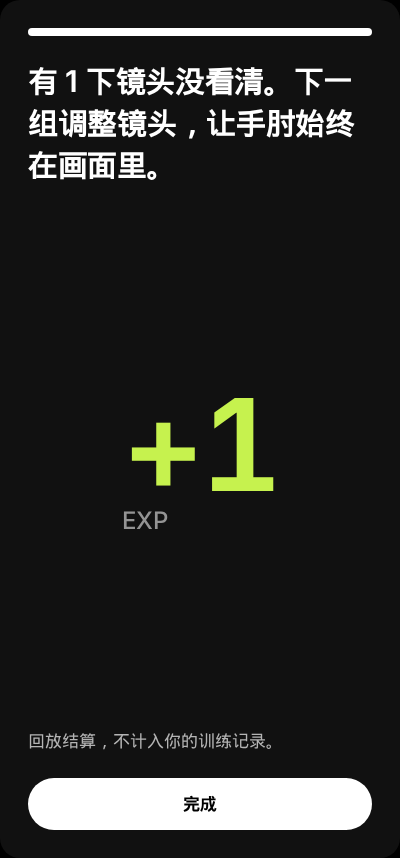
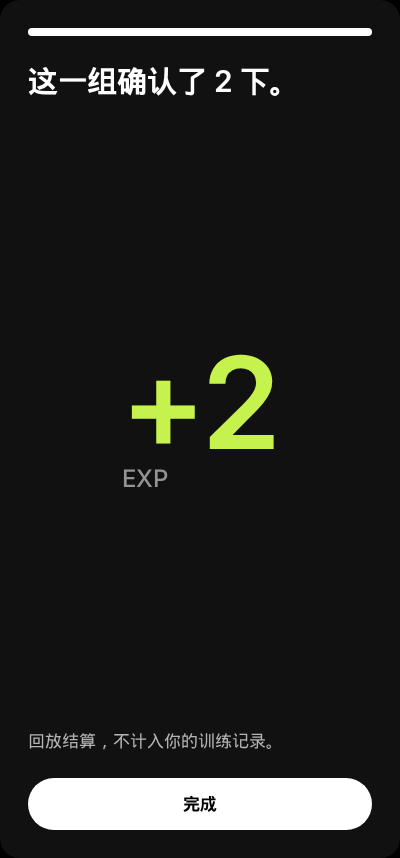

# Recorded-pose recovery and source-held-out check

This follow-up recovers an actual missed repetition in Future Fitness. The previous application confirmed one of its two formal reference movements; the candidate confirms both. It does not add a chart, change rewards, interpolate missing joints, or lower counting thresholds. The fixed eighteen-clip cohort changed from 20/36 to 22/36 matched formal reference repetitions, with 14 missed and zero unmatched confirmations. No previously matched window was lost; calibration completion remained at nine clips. Four new source groups matched 12/12 in both versions, so that check establishes no additional recognition gain.

## What changed

At source time 17.400 s, the previous full model output was completely empty, between directly observed neighboring frames. During ordered recording analysis, the browser already holds a decoded image on a canvas. An empty result now receives at most one additional inference on that exact image. The model receives a strictly later internal timestamp, while the published observation keeps the original source timestamp and is emitted only once. A second empty result stays missing. Existing arm filtering, calibrated counters, review evidence gates and reward policy remain in place.

A successful retry adds one model call only where the first result was empty; persistently empty sections can require twice as many calls. This is a bounded recovery attempt, not a speed improvement. It is limited to recordings using ordered source analysis. Live-camera input is unchanged and has no new throughput or recognition claim.

The second development gain is Dynamic Fitness: its first calibration cycle is now retained, completing calibration at 12.53 s instead of 16.40 s. It confirms one of two formal reference movements instead of zero; the final movement still fails. The new application observation at 1.200 s contains a pose where the baseline was empty. Retrying also changes the model's subsequent tracking state, and the selected calibration side changed from right to left; this is not a claim that all other inferred poses are identical. An additional fresh baseline/candidate pair reproduced 0/2 versus 1/2 and the same calibration completion times. No production code or thresholds changed for this replication.

## Same-recording application result

The before screen reports one unverified attempt and +1 replay EXP. The after screen confirms two repetitions and +2 replay EXP. This is the unchanged one-EXP-per-confirmed-repetition rule, not a new reward. Both screens explicitly state that replay settlement does not enter personal training records.

## Evidence and evaluation protocol

The unchanged eighteen-clip development cohort was freshly processed through the actual candidate application. Its baseline is the prior 71c4bfd application run, with all six captured application-source hashes checked against that commit in every group; those baseline runs were reused, not rerun in this round. The primary timestamp audit must reproduce each actual UI calibration and verified count before matching reference windows. Wrist-trace-only matching cannot locate count-only repetitions and is not substituted for the primary count.

Four new source groups were chosen and visually annotated before their model evaluation: Tuti Isnawati, JULLIAN PRODUCTION, Jill Burrow and Harvey Tan Villarino. The freeze record contains the candidate sources and annotated-manifest hashes, and each paired job checks those plus the original-media hashes. Both 71c4bfd and candidate run fresh in separate application checkouts with separate Vite caches. The complete original files are retained without loops, temporal clipping or spatial cropping. The matching rule remains first three complete cycles reserved for calibration, then one completion per bottom-to-return window with a 0.35 s endpoint allowance.

The four-source set contains 12 formal reference movements, all from the two pulldown recordings. Both squat recordings are too short to provide formal references and remain calibration/abstention controls. They do not establish held-out squat-counting efficacy. Initial/final partial movements and moving/cropped views are explicitly described in the manifest. The labels are provisional agent visual annotations at 0.25 s intervals, not independent human ground truth. No source was discarded after its outcome and no candidate retuning used these outcomes; source-held-out does not imply unseen by the pretrained pose model.

The six-source 2/10 result in the preceding repair report is historical and was not rerun for this follow-up. It must not be reported as this candidate's six-source score. Across the two rounds there are 28 distinct recordings, while this round has 28 fresh application runs across 22 distinct recordings (18 development, four new sources in two versions, and two additional runs of the existing Dynamic clip). Repetition of that development clip is not another held-out source.

## Boundaries and unsuccessful diagnostics

The correctly decoded multi-person Szat squat probe evaluated two model candidates. All 560 decoded samples had distinct image fingerprints, but only one sample contained a second pose candidate. Neither fixed slot nor an exploratory nearest-feet selection completed calibration. This experiment was not shipped as a new multi-person feature. A previous static-decoded-frame probe was invalid and is not used as recognition evidence.

Other recorded problems remain view changes, corrupt or missing arm/leg positions, incomplete calibration and low bilateral availability. The change does not establish physical onset-to-offset timing accuracy, torso-tilt accuracy, live-camera performance, reduced injury risk or improved participant training outcomes. Missing measurements remain missing; EXP and wardrobe rules are unchanged. Source media and raw pose streams stay outside the repository.

## Verification records

The [paired comparison](results/recording-retry-comparison.json) retains all lost/gained reference windows, including the separate Dynamic replication. The [application records](results/recording-retry-application-check.json) retain all 28 fresh runs and browser/source identities. The [primary development audit](results/recording-retry-cohort-audit.json), [held-out baseline audit](results/recording-retry-heldout-baseline-audit.json) and [held-out candidate audit](results/recording-retry-heldout-candidate-audit.json) retain event timestamps. The [source manifest](results/recording-retry-heldout-sources.json) and [freeze record](results/recording-retry-freeze.json) record the preregistered source set and candidate. The [gap check](results/recording-retry-gap-check.json) confirms that Future Fitness publishes the same 287 source positions before and after the repair, with the formerly empty 17.400 s observation now available.

The [validation record](results/recording-retry-validation-check.json) reports 205 passing tests across 33 files, a passing production build, and eleven passing browser scenarios. Those include four recorded classroom conditions and the facilitator flow using the actual offline ZIP. The packaged file also passed full/bounded/open-ended/suffix/invalid/HEAD transport checks. The facilitator flow took 197.1 seconds on four allocated CPUs; this is not real-time performance or a controlled speed comparison against earlier allocations. Recovery-specific tests first reproduced the missing retry, then passed after the change, and cover one published source observation, at most one retry, no retry for an already returned pose, and unchanged live-camera behavior.

The previous [calibration repair report](recognition-reliability.md) documents the earlier 18/36 to 20/36 development change and its distinct six-source 2/10 result. The two rounds must not be pooled into a claim of general recognition accuracy.

## Reproduction

Use the source manifest and hashes to obtain the originals. Run the existing application cohort script for each index group, preserving separate baseline and candidate checkouts. Then run audit-cohort-counts.mjs against the exact captured frames and compare reference windows, including previously matched windows that might be lost. The accompanying application records retain source hashes and per-source UI outcomes; the primary audit retains completion timestamps. All video decoding, inference, tests, builds and browser rendering in this round ran on allocated HPC compute nodes.
